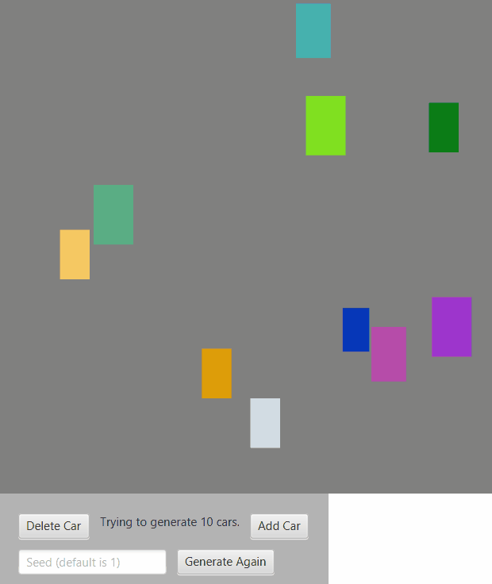

# Parking Lot Generator

A small procedural content generation (PCG) demo built with Java and FXGL. It fills a parking lot
with randomly sized and coloured cars, places them without overlaps and lets you regenerate the
layout from a seed.




## Features

- **Deterministic seeds** – positions, car types and colours all come from one seeded `java.util.Random`, so the same seed always produces the same parking lot.
- **Collision-free layout** – each car is placed by rejection sampling: up to 300 random positions are tried and checked with an AABB overlap test against cars already placed, plus a bounds check.
- **Car types** – sedan, SUV, van and sports car, each with its own footprint and a random colour.
- **Entity factories** – cars and the lot are spawned through FXGL `EntityFactory` classes (`CarFactory`, `SimpleFactory`).
- **Live controls** – add or remove cars (1–100), enter a seed and regenerate.

## How it works

```text
for each car:
    pick a random type and colour
    repeat up to 300 times:
        pick a random (x, y) from the seeded RNG
        if the car fits inside the lot and overlaps no placed car:
            spawn it and continue with the next car
```

If no free spot is found within 300 attempts the car is skipped, so dense lots end up with fewer
cars than requested instead of overlapping ones (e.g. 100 requested → ~80 placed).

## Getting started

Requirements: JDK 21 and Maven (or IntelliJ IDEA, which imports the `pom.xml` directly).

```bash
git clone https://github.com/N0V1RU5/parking-lot-generator.git
cd parking-lot-generator
mvn compile exec:java -Dexec.mainClass=com.n0v1.game.ParkPCGApp
```

In IntelliJ IDEA: open the folder, let Maven import the project and run `ParkPCGApp`.

## Project structure

```text
src/main/java/com/n0v1/game/
├── ParkPCGApp.java        app entry point, settings and UI
├── CarFactory.java        spawns car entities
├── SimpleFactory.java     spawns the parking lot
└── model/
    ├── Car.java           car data (size, type, colour, position)
    └── CarSpawner.java    placement and collision checks
```

## Possible improvements

- Place cars into parking-space slots (rows and lanes) instead of free positions.
- Random rotation with oriented bounding box (OBB) collisions.
- A spatial grid for collision checks when the car count grows.

## Built with

- [FXGL](https://github.com/AlmasB/FXGL) – Java game framework
- [JavaFX](https://openjfx.io/)
